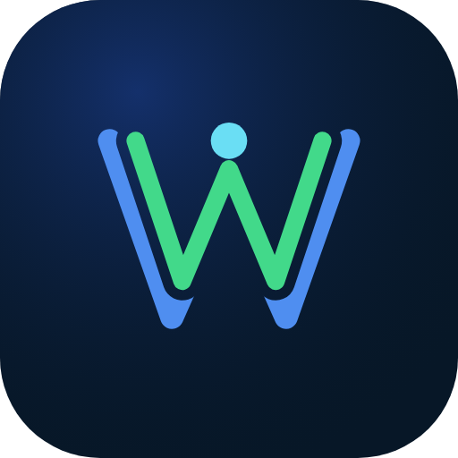

<p align="center">
  
</p>

# WovenLens releases

**All your threads. A clearer view.**

[WovenLens](https://wovenlens.com) is a desktop workspace that brings AI and your Gmail, calendars and connected tools together. Start the day with Daily Lens, a briefing built from widgets like unread email, today's events, open tickets and your stocks. Hand repeating work to agents with workflows and scheduled jobs.

This repository only holds the installers. WovenLens's source code isn't published here.

## Download

| Platform                             | Download                                                                                                                        |
| ------------------------------------ | ------------------------------------------------------------------------------------------------------------------------------- |
| Mac with Apple silicon (M1 or later) | [WovenLens-mac-arm64.dmg](https://github.com/greatmediaetc/wovenlens-releases/releases/latest/download/WovenLens-mac-arm64.dmg) |

That link always gets the newest version. Every version, with release notes and SHA-256 checksums, is listed under [Releases](https://github.com/greatmediaetc/wovenlens-releases/releases). Builds for Intel Macs and Windows aren't available yet.

## Install on a Mac

1. Open the downloaded `.dmg` and drag **WovenLens** into **Applications**.
2. WovenLens is a development preview and isn't signed or notarized by Apple yet, so macOS will block it the first time you open it. To open it anyway:
   - In **Applications**, Control-click **WovenLens**, choose **Open**, then choose **Open** again.
   - If macOS still won't open it, go to **System Settings → Privacy & Security** and click **Open Anyway** next to the WovenLens message.
3. You only need to do this once. After that, WovenLens opens normally.

### Check the download (optional)

Each release includes `SHA256SUMS.txt`. In Terminal, run:

```sh
shasum -a 256 ~/Downloads/WovenLens-mac-arm64.dmg
```

The result should match the line for that file in `SHA256SUMS.txt`.

## Getting started

1. **Add an AI model.** Open **Connections → Models** and add an API key for OpenAI, Anthropic or xAI. You choose the provider, and requests go straight from your Mac to that provider.
2. **Connect your services.** Under **Connections → Services**, connect the ones you want to use, such as Google (Gmail and Google Calendar), Apple Calendar, Jira, GitLab or Slack. You can also add MCP servers for other tools.
3. **Set up Daily Lens.** Add widgets, drag them into order, then click **Test widgets** and **Save**.
4. **Ask your agents.** Start a conversation, or build a workflow and schedule it as a job.

## Privacy

- Your conversations, settings and history are stored on your Mac.
- Credentials are encrypted with your Mac's keychain-backed storage.
- Content is only sent to the AI provider you choose and the services you connect.
- Google access is read-only. WovenLens never sends, deletes or changes email or calendar events.

Read the full [privacy policy](https://wovenlens.com/privacy/) and [terms](https://wovenlens.com/terms/).

## Updating

Download the latest `.dmg` and drag WovenLens into **Applications** again, choosing **Replace**. Your workspace, settings and connections are kept.

## Uninstalling

Drag **WovenLens** from **Applications** to the Trash. Your saved workspace stays in `~/Library/Application Support/ensemble-desktop` in case you reinstall. Delete that folder too if you want to remove everything.

## Support

- Questions or problems: [support@wovenlens.com](mailto:support@wovenlens.com)
- Privacy requests: [privacy@wovenlens.com](mailto:privacy@wovenlens.com)
- Videos and walkthroughs: [YouTube](https://www.youtube.com/@WovenLens-x1g)

When you report a problem, include the WovenLens version (shown in the release name) and your macOS version.
